<div align="center">

**English** · [简体中文](README.zh-CN.md) · [繁體中文](README.zh-TW.md)

<picture>
  <source media="(prefers-color-scheme: dark)" srcset="Logo/talvio/png/lockup-dark-h256.png" />
  
</picture>

### Talk to your computer. It types, answers, and gets things done.

Dictation that works in any app, a voice assistant that can act on your computer,
meeting notes, and a phone app that turns your phone into a wireless mic and remote.
Local-first: speech is transcribed on your own computer unless you choose a cloud provider.

[](LICENSE)
[](#install)
[](https://tauri.app)

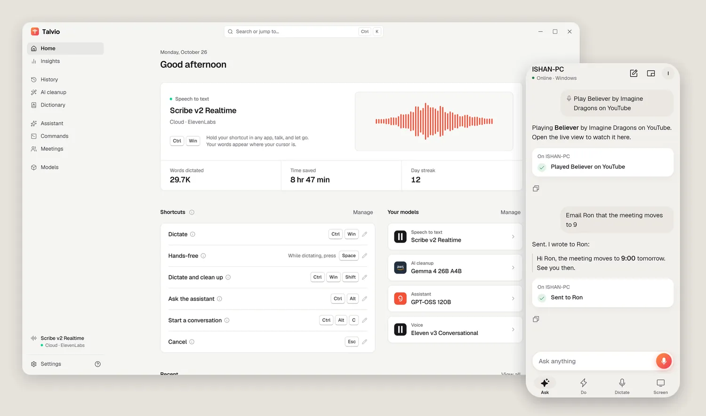

**[Download for Windows, macOS and Linux](https://github.com/ishangautam7/Talvio/releases/latest)** · [Website](https://talvio.sentramind.dev) · [Android app](https://talvio.sentramind.dev/download/android)

If Talvio saves you some typing, a ⭐ helps other people find it.

</div>

## Contents

- [Highlights](#highlights)
- [Install](#install)
- [First run](#first-run)
- [How to use](#how-to-use)
  - [Dictation](#dictation) · [AI cleanup](#ai-cleanup) · [Assistant](#assistant) · [Calls](#calls) · [Voice commands](#voice-commands) · [Meetings](#meetings) · [History and Insights](#history-and-insights) · [Dictionary](#dictionary) · [Models](#models)
- [Phone app](#phone-app)
- [Self-hosting the account server](#self-hosting-the-account-server)
- [Keyboard shortcuts](#keyboard-shortcuts)
- [Privacy](#privacy)
- [Command line](#command-line)
- [Troubleshooting](#troubleshooting)
- [Development](#development)
- [License and attribution](#license-and-attribution)

## Highlights

- **Dictate anywhere.** Hold a key, talk, let go. Your words appear wherever the cursor is, in any app.
- **Runs on your computer.** Speech-to-text runs locally on transcribe.cpp (Parakeet, Nemotron, Whisper and the rest of a 69-model catalog), on your graphics card or processor. Cloud providers are optional and use your own key.
- **An assistant you talk to.** Ask a question about selected text, your screen or anything else and hear the answer, or start a hands-free conversation.
- **Voice commands.** "Play Believer by Imagine Dragons", "turn the volume down", "email me the project report": Talvio does it in your own apps.
- **Meetings.** Records your microphone and the computer's sound as two lanes, transcribes live and writes notes when the call ends.
- **Your phone as a mic and remote.** Ask, give commands, dictate into the computer, or watch its screen from the Talvio phone app.
- **Clean output.** Optional AI cleanup removes filler words and applies spoken corrections; a dictionary keeps names spelled right.

## Install

Download the latest version from the [Releases page](https://github.com/ishangautam7/Talvio/releases/latest) or [talvio.sentramind.dev](https://talvio.sentramind.dev/download).

| Platform    | How |
| ----------- | --- |
| **Windows** | Run `Talvio_<version>_x64-setup.exe` (or the `.msi`). The installer is not signed yet, so Windows SmartScreen may warn you: choose **More info → Run anyway**. |
| **Linux**   | `Talvio_<version>_amd64.AppImage` (make it executable and run it) or the `.deb`. ARM64 builds are there too. Speech runs on Vulkan or the CPU. |
| **macOS**   | `Talvio_<version>_aarch64.dmg` (Apple silicon) or `_x64.dmg` (Intel). The app is not signed by Apple yet, so after dragging it to Applications run `xattr -dr com.apple.quarantine /Applications/Talvio.app` once. Talvio asks for **Microphone** and **Accessibility** permission so it can hear you and type into other apps. |
| **Android** | The phone app's APK is at [talvio.sentramind.dev/download/android](https://talvio.sentramind.dev/download/android), or build it from [`mobile/`](mobile/README.md). |

Building from source, in short (full details in [BUILD.md](BUILD.md)):

```bash
git clone https://github.com/ishangautam7/Talvio.git
cd Talvio
bun install
mkdir -p src-tauri/resources/models
curl -o src-tauri/resources/models/silero_vad_v4.onnx https://blob.handy.computer/silero_vad_v4.onnx
bun run tauri build      # or `bun run tauri dev` to run it straight away
```

## First run

Talvio opens a short setup the first time it starts.

1. **Pick a speech model.** Five are offered: Parakeet 0.6B (English, recommended), Nemotron 3.5 (28 languages, recommended), Canary 180M Flash, Cohere Transcribe and Whisper Medium. Only the one you pick is downloaded, and you can add or switch models later on the Models page. Prefer the cloud? Choose **Set up later** and pick a provider under **Models → Speech to text → Cloud**.
2. **Take the tour.** Three short scenes show dictation, the assistant and a conversation with their keys. The model keeps downloading in the background; if you press the dictation keys before it lands, the pill shows the download progress.

<table>
<tr>
<td width="50%">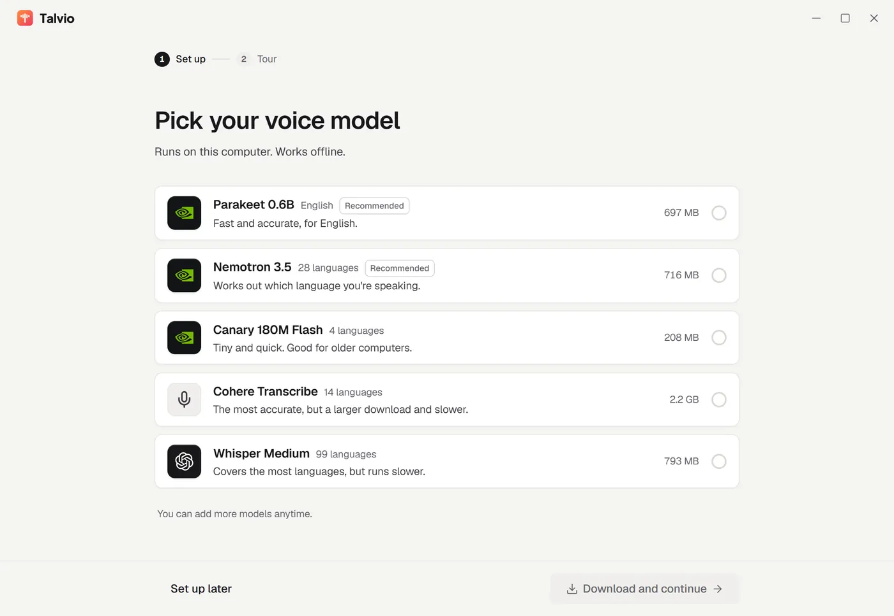</td>
<td width="50%">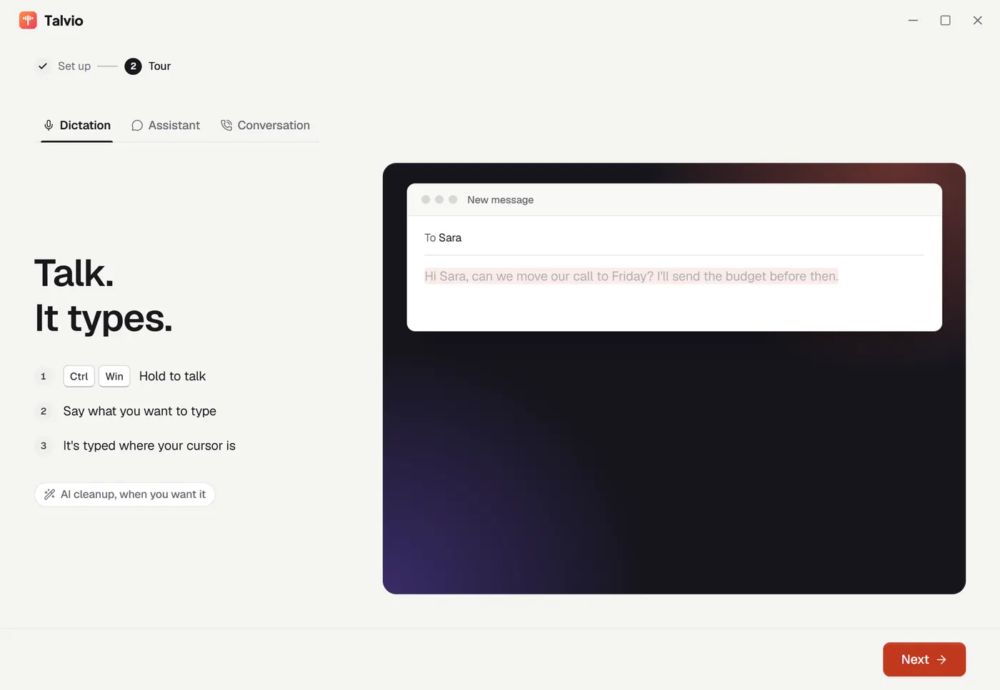</td>
</tr>
</table>

On macOS, set **System Settings → Keyboard → Press 🌐 key to → Do Nothing**, or pressing Fn also opens the emoji picker.

## How to use

The Home page shows which model is listening, your shortcuts and your numbers. Every page, model and setting is also one search away: press <kbd>Ctrl</kbd> + <kbd>K</kbd> (<kbd>⌘</kbd> + <kbd>K</kbd> on a Mac).

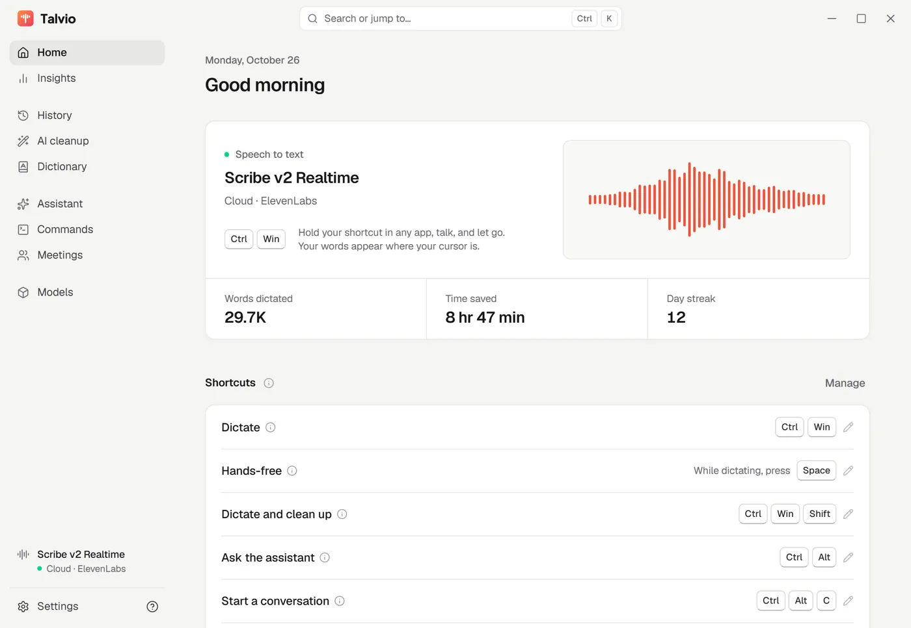

<details>
<summary>Dark theme</summary>

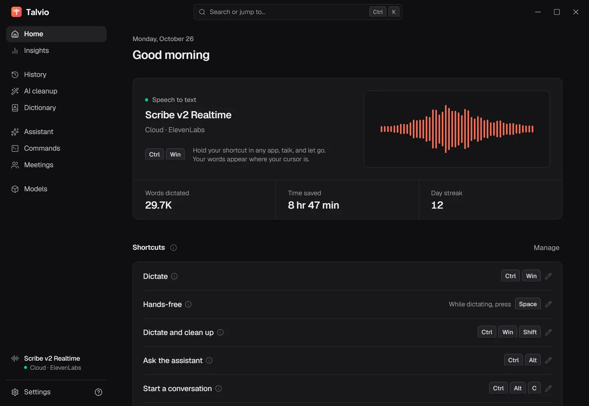

</details>

### Dictation

| Windows                                    | macOS              | Linux                              |
| ------------------------------------------ | ------------------ | ---------------------------------- |
| <kbd>Left Ctrl</kbd> + <kbd>Left Win</kbd> | <kbd>Fn</kbd> (🌐) | <kbd>Ctrl</kbd> + <kbd>Space</kbd> |

1. Click into any text field.
2. **Hold** the dictation keys and talk. A small pill at the bottom of the screen shows that Talvio is listening; with a streaming model it shows your words as you speak.
3. **Let go.** The text is typed where your cursor is.

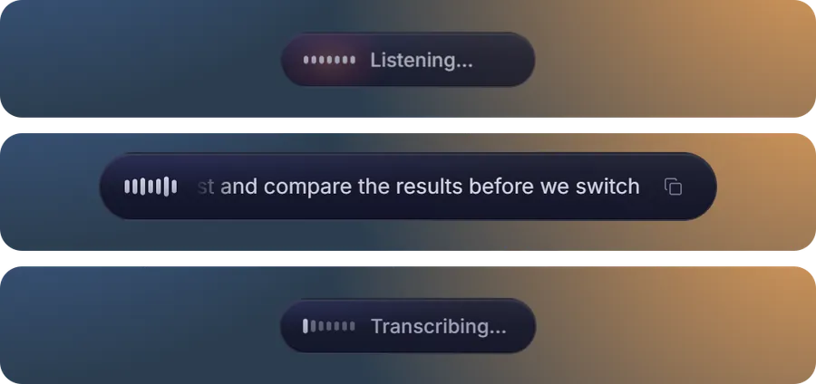

- **Hands-free.** While holding the dictation keys, press <kbd>Space</kbd> and let go: Talvio keeps listening until you press the dictation keys again or click ✓ on the pill. With **Hold to talk** turned off (Settings → Shortcuts), every dictation works this way: tap to start, tap to stop. On Linux, where the default keys already contain Space, turn Hold to talk off instead.
- **Stop after silence.** A hands-free dictation can end itself after a pause you choose (Settings → Shortcuts, off by default).
- **Undo.** Pressed <kbd>Esc</kbd> by mistake? The pill offers **Undo** for a couple of seconds and the recording is kept in History, where it can be recovered later. A failed transcription offers **Try again**.
- **Smart spacing.** Two dictations in a row into the same field get the space between them (on by default).

### AI cleanup

| Windows                                                       | macOS                            | Linux                                                 |
| ------------------------------------------------------------- | -------------------------------- | ----------------------------------------------------- |
| <kbd>Left Ctrl</kbd> + <kbd>Left Win</kbd> + <kbd>Shift</kbd> | <kbd>Fn</kbd> + <kbd>Shift</kbd> | <kbd>Ctrl</kbd> + <kbd>Shift</kbd> + <kbd>Space</kbd> |

Turn it on from the **AI cleanup** page. Cleanup removes filler words, fixes punctuation and follows spoken corrections, so "at ten, actually no, eleven" comes out as "at eleven". It can have its own shortcut (the dictation keys plus Shift) or run on every dictation, and you can add a writing style: Professional, Friendly, Concise, Formal, Casual, or one you write. Short dictations (under 15 words by default) skip cleanup when it rides on the dictation key.

Cleanup can run on **SpeakoFlow Mini**, a small English-only model trained for exactly this job that runs on your computer, on the built-in llama.cpp engine with another local model, or on any cloud model you have a key for.

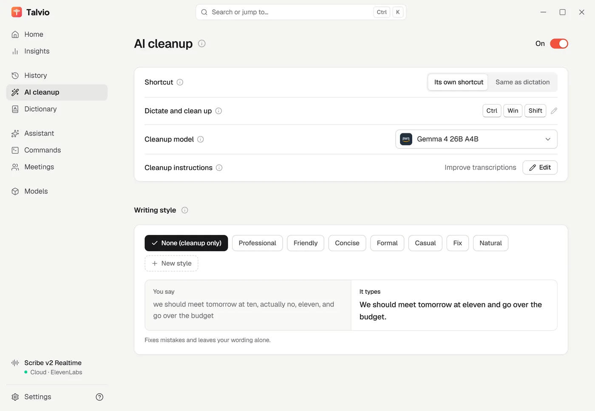

### Assistant

| Windows                                    | macOS                           | Linux                                               |
| ------------------------------------------ | ------------------------------- | --------------------------------------------------- |
| <kbd>Left Ctrl</kbd> + <kbd>Left Alt</kbd> | <kbd>Fn</kbd> + <kbd>Ctrl</kbd> | <kbd>Ctrl</kbd> + <kbd>Alt</kbd> + <kbd>Space</kbd> |

Select some text (or nothing), **hold** the ask keys and say what you want: "translate this to Spanish", "write a polite reply saying I can't make Thursday", "what does this error mean?". A glowing orb appears at the edge of the screen and **answers out loud**. When you asked about selected text, an **Insert** / **Replace** chip puts the answer back into the app.

<p align="center"></p>

What it can do, each switched on the **Assistant** page:

- **Act on your computer.** With [voice commands](#voice-commands) on, "open YouTube" or "email Ron the notes" is carried out, and the orb tells you what it did.
- **Look at your screen** when the question is about something visible ("summarize this error"). Off by default, separately for quick asks and conversations; when on, the model decides per message whether to look.
- **Search the web** (Serper, Brave, Tavily, Exa, SerpAPI or TinyFish, with your key).
- **Set reminders**: "remind me to send the invoice in twenty minutes". Reminders survive a restart and pop up without taking your keyboard.
- **Remember you** (off by default). A local, editable memory of things worth knowing about you.

A quick ask continues the previous one for 10 minutes by default (**Remember the conversation**).

<table>
<tr>
<td width="60%">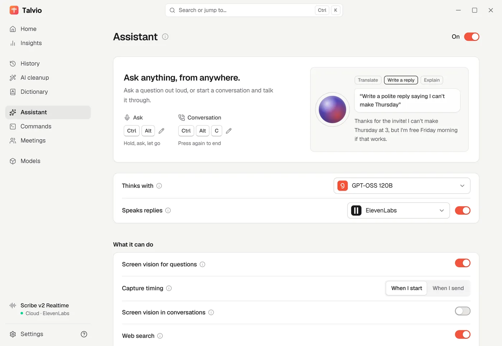</td>
<td width="40%" valign="top">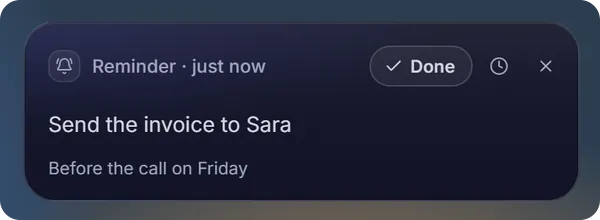<br /><sub>A reminder the assistant set.</sub></td>
</tr>
</table>

### Calls

| Windows                                                   | macOS                                          | Linux                                           |
| --------------------------------------------------------- | ---------------------------------------------- | ----------------------------------------------- |
| <kbd>Left Ctrl</kbd> + <kbd>Left Alt</kbd> + <kbd>C</kbd> | <kbd>Fn</kbd> + <kbd>Ctrl</kbd> + <kbd>C</kbd> | <kbd>Ctrl</kbd> + <kbd>Alt</kbd> + <kbd>C</kbd> |

A call is a hands-free conversation: press the keys once and just talk. The assistant answers aloud and you can interrupt it at any time. <kbd>Esc</kbd> stops the current answer and keeps the call; press the call keys again (or click End) to hang up. Need to type something mid-call? Dictate as usual: the call pauses while you dictate and resumes afterwards.


Answers can be spoken by a voice on your computer (Kokoro, Kitten, Pocket TTS, Supertonic) or a cloud voice such as ElevenLabs or OpenAI. Choose it under **Models → Voice**.

### Voice commands

| Windows                                                       | macOS                                              | Linux                                                                  |
| ------------------------------------------------------------- | -------------------------------------------------- | ---------------------------------------------------------------------- |
| <kbd>Left Ctrl</kbd> + <kbd>Left Alt</kbd> + <kbd>Shift</kbd> | <kbd>Fn</kbd> + <kbd>Ctrl</kbd> + <kbd>Shift</kbd> | <kbd>Ctrl</kbd> + <kbd>Alt</kbd> + <kbd>Shift</kbd> + <kbd>Space</kbd> |

Turn on the **Commands** page, choose the model that runs commands (it needs that provider's API key), then hold the command keys and say what you want. Things to try:

| Say                                                    | What happens                                                            |
| ------------------------------------------------------ | ----------------------------------------------------------------------- |
| "Play Believer by Imagine Dragons"                     | Opens the song and plays it (anything already playing is paused first). |
| "Pause" · "Resume" · "Turn the volume down"            | Controls what's playing and the system volume.                          |
| "Open YouTube" · "Switch to Chrome" · "Open my resume" | Opens sites, apps and files, or brings an open window forward.          |
| "Send an email to Ron about a meeting at 9:00"         | Opens Gmail with the email written and sends it.                        |
| "Email me the project report"                          | Finds the file on your computer, attaches it in Gmail and sends it.     |
| "Add lunch with Sara on Friday at 1 to my calendar"    | Opens the Google Calendar event form, filled in.                        |

**It acts without asking.** A command you speak is the request, so a send is carried out. To check first, say so: "draft it", "wait for me before sending", "ask before sending". Or turn on **Ask before sending or deleting**, and anything that sends, posts or deletes waits for you to press **Do it** on a small card. **Dry run** shows what a command would do without doing it, and the **Try it** box lets you type a command instead of saying it.

For a request no built-in action covers, Talvio can read the window in front (Windows only for now) and work through it step by step, still holding anything that sends, buys or deletes for your confirmation. <kbd>Esc</kbd> stops a command at any point.

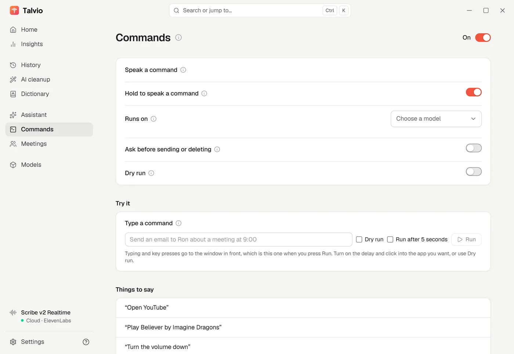

### Meetings

Open **Meetings** and click **Start recording** before a call. Talvio records your microphone and the computer's sound as two separate lanes, so it always knows which words were yours, and transcribes as people talk. No bot joins the meeting, so it works with any meeting app. When it ends, notes are written with a summary, decisions and follow-ups, and you can ask questions about the meeting later. On Windows it can also offer to record when it notices a call.

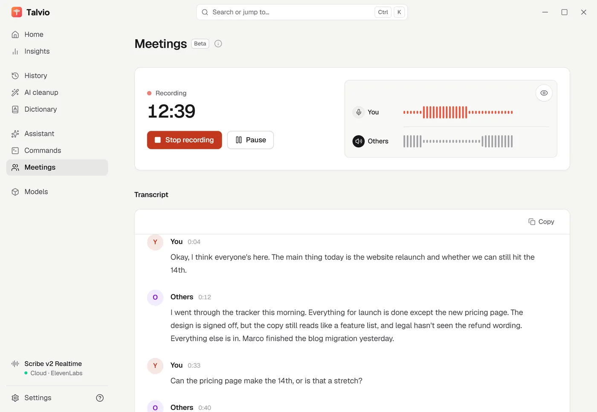

On macOS, recording the other side of a call needs a virtual audio device such as [BlackHole](https://github.com/ExistentialAudio/BlackHole).

### History and Insights

**History** keeps your dictations, questions and conversations by day. Play a recording back, transcribe it again, recover a dismissed one, or continue a chat as a call. Old recordings can be deleted automatically by count or age (Settings → Privacy & data).

**Insights** counts words dictated, your speaking speed, time saved against typing, questions asked, meetings recorded and your day streak, with six months of activity. **Share** turns a figure into an image card.

<table>
<tr>
<td width="50%">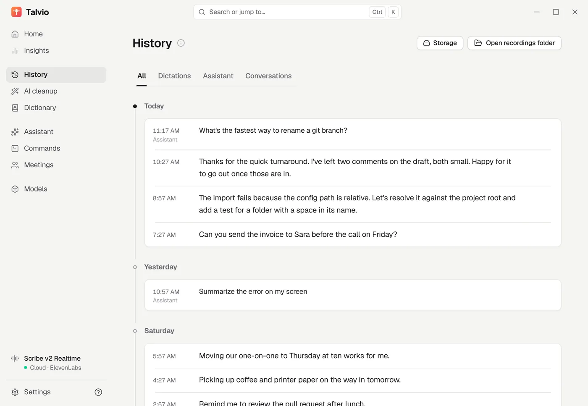</td>
<td width="50%">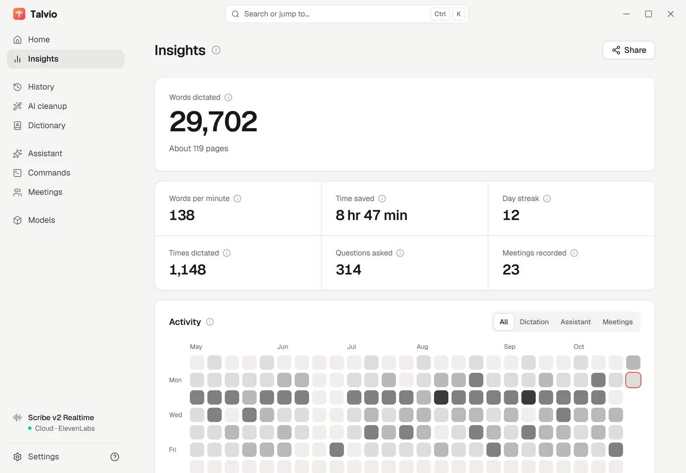</td>
</tr>
</table>

### Dictionary

Add names, product terms and unusual spellings under **Your words** and they are passed to the speech model so it gets them right. **Replacements** swap one phrase for another after transcription. On Windows, **Learn words I correct** watches for a one-word fix you make right after a dictation and adds it for you.

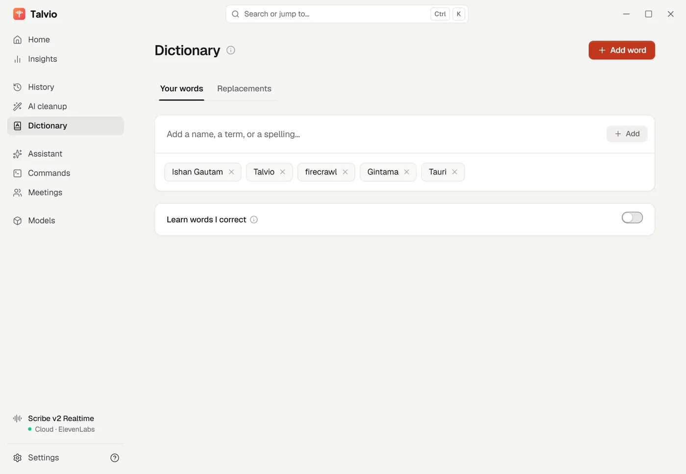

### Models

The **Models** page is organised by job: **Speech to text**, **AI cleanup**, **Assistant** and **Voice**. Each job runs either **On this computer** or in the **Cloud**.

- **On this computer:** download speech models from the catalog (Recommended first, All models one click away, filtered by language), or point Talvio at a `.gguf` / Whisper `.bin` you already have, or a whole folder of them. Nothing is copied. The assistant and cleanup can run on the built-in llama.cpp engine, fully offline, or on your own Ollama or LM Studio server.
- **Cloud:** speech-to-text from ElevenLabs, Deepgram, OpenAI, OpenRouter, Amazon Transcribe, Azure AI Speech and others, or any OpenAI-compatible server; chat models from OpenAI, Anthropic, Google, OpenRouter, Groq, AWS Bedrock, Azure and many more.

**API keys are stored in your operating system's keychain**, not in a settings file. Where speech runs (processor or graphics card) is one setting: Settings → Advanced → Performance → **Speech processing**.

<table>
<tr>
<td width="50%">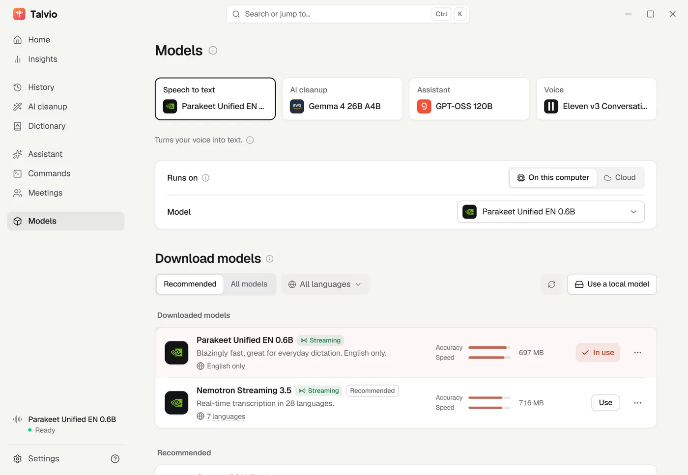</td>
<td width="50%">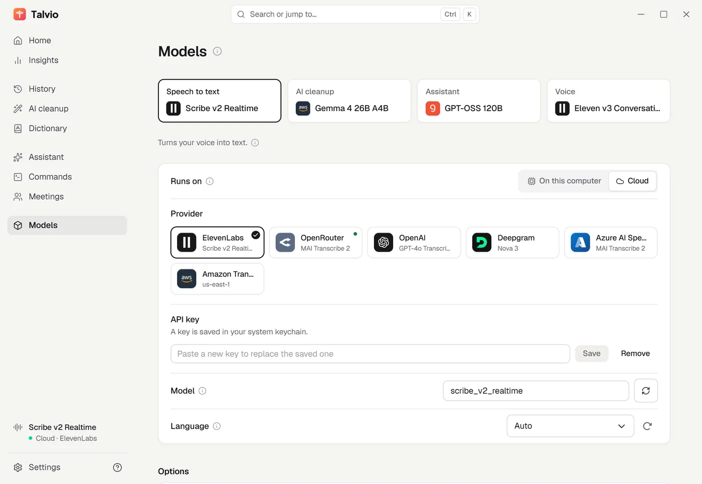</td>
</tr>
</table>

## Phone app

Sign in to the same account on your computer and your phone, and the phone becomes a wireless mic and remote for the computer. It works on the same Wi-Fi or across the internet, through the account server.

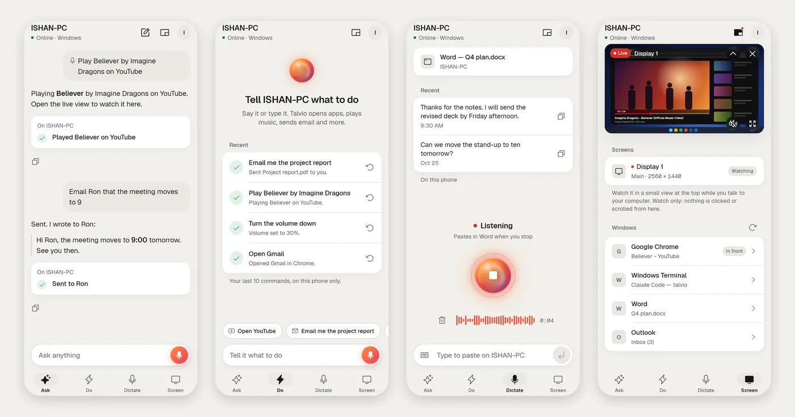

**Set it up**

1. On the computer, open **Settings → Account** and sign in (email and password, or Google when the server offers it). Turn on **Phone dictation**.
2. On the phone, install the app and sign in to the same account.
3. The first time the phone sends anything, the computer asks **Allow this phone?** Click **Allow**. Only allow phones you own: an allowed phone can type into your apps. You can allow or remove phones ahead of time in Settings → Account.

<table>
<tr>
<td width="50%" valign="top">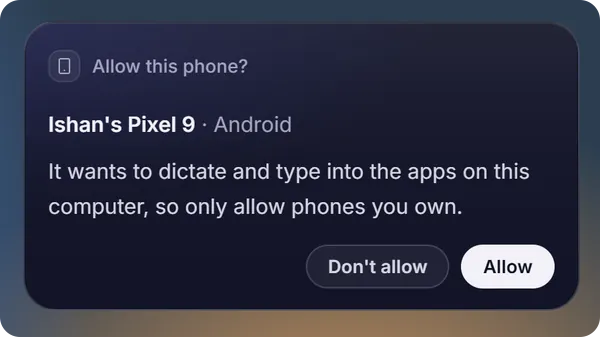</td>
<td width="50%" valign="top">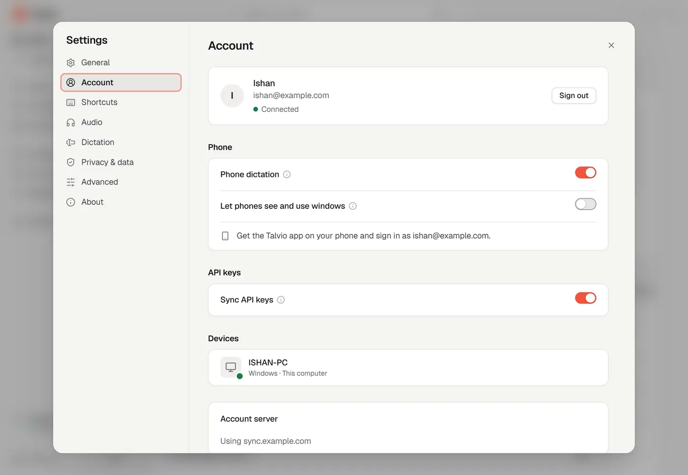</td>
</tr>
</table>

**What the phone can do** (four tabs):

- **Ask:** talk to the assistant running on your computer, typed or spoken. It can act on the computer just like a spoken ask.
- **Do:** give a voice command ("play some music", "email me the project report") and see what happened.
- **Dictate:** speak on the phone; the computer transcribes with its own speech model and pastes at its cursor. Or type on the phone and the computer pastes it.
- **Screen:** watch a window or the whole screen live. In full screen, switch from **View** to **Control** to click (tap, double tap, hold for a right click) and scroll with two fingers; typing and keys work in either; a button that sends, buys, posts or deletes is asked about on the phone first. Turn on **Let phones see and use windows** in Settings → Account first (off by default, since window titles alone say a lot). A "Phone is viewing" card on the computer has a Stop button.

The account server keeps accounts and devices (and, if you turn on **Sync API keys**, your provider keys, encrypted). Recordings and text pass through it from one device to the other and are never stored.

<details>
<summary>Dark theme</summary>

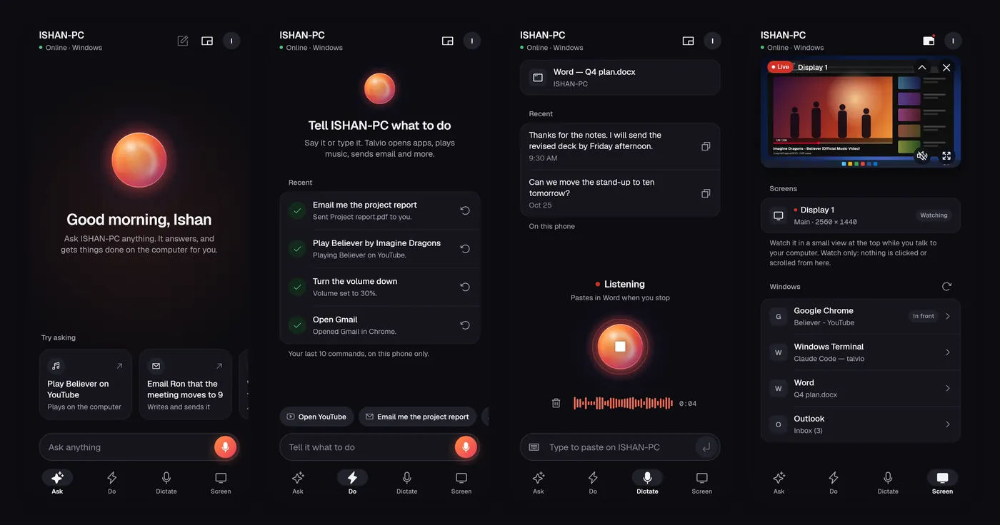

</details>

## Self-hosting the account server

Accounts are only needed for the phone app; the desktop app works fully without one. The account server in [`server/`](server/README.md) is small and self-hostable: Bun and SQLite, no runtime dependencies, with a Docker setup. Its README covers running it, how the apps find it, Google sign-in and TURN for live view across strict networks. Every route and message is specified in [`server/PROTOCOL.md`](server/PROTOCOL.md).

```bash
cd server
bun install
bun run dev        # http://localhost:8787
```

## Keyboard shortcuts

| Action                       | Windows                                                       | macOS                                              | Linux                                                                  |
| ---------------------------- | ------------------------------------------------------------- | -------------------------------------------------- | ---------------------------------------------------------------------- |
| Dictate                      | <kbd>Left Ctrl</kbd> + <kbd>Left Win</kbd>                    | <kbd>Fn</kbd>                                      | <kbd>Ctrl</kbd> + <kbd>Space</kbd>                                     |
| Hands-free (while dictating) | <kbd>Space</kbd>                                              | <kbd>Space</kbd>                                   | turn Hold to talk off                                                  |
| Dictate and clean up         | <kbd>Left Ctrl</kbd> + <kbd>Left Win</kbd> + <kbd>Shift</kbd> | <kbd>Fn</kbd> + <kbd>Shift</kbd>                   | <kbd>Ctrl</kbd> + <kbd>Shift</kbd> + <kbd>Space</kbd>                  |
| Ask the assistant            | <kbd>Left Ctrl</kbd> + <kbd>Left Alt</kbd>                    | <kbd>Fn</kbd> + <kbd>Ctrl</kbd>                    | <kbd>Ctrl</kbd> + <kbd>Alt</kbd> + <kbd>Space</kbd>                    |
| Start or end a call          | <kbd>Left Ctrl</kbd> + <kbd>Left Alt</kbd> + <kbd>C</kbd>     | <kbd>Fn</kbd> + <kbd>Ctrl</kbd> + <kbd>C</kbd>     | <kbd>Ctrl</kbd> + <kbd>Alt</kbd> + <kbd>C</kbd>                        |
| Voice command                | <kbd>Left Ctrl</kbd> + <kbd>Left Alt</kbd> + <kbd>Shift</kbd> | <kbd>Fn</kbd> + <kbd>Ctrl</kbd> + <kbd>Shift</kbd> | <kbd>Ctrl</kbd> + <kbd>Alt</kbd> + <kbd>Shift</kbd> + <kbd>Space</kbd> |
| Cancel                       | <kbd>Esc</kbd>                                                | <kbd>Esc</kbd>                                     | <kbd>Esc</kbd>                                                         |
| Search the app               | <kbd>Ctrl</kbd> + <kbd>K</kbd>                                | <kbd>⌘</kbd> + <kbd>K</kbd>                        | <kbd>Ctrl</kbd> + <kbd>K</kbd>                                         |

- Dictate and clean up works once AI cleanup is on with its own shortcut. Voice command works once Voice commands are on.
- Dictation, the assistant and commands each have their own **Hold to talk** switch in Settings → Shortcuts. Off means tap once to start and again to stop.
- <kbd>Esc</kbd> is only taken while something is running (a recording, a spoken answer), so other apps keep it the rest of the time.
- Click a shortcut's keys to change them. **Add another** gives a shortcut a second set of keys, including a mouse button (middle, Back or Forward) on Windows and macOS. Cancel, the call and the hands-free key can be turned off.

## Privacy

By default your voice is transcribed on your computer and never uploaded. Talvio has no analytics, no telemetry and no tracking, and the desktop app needs no account. Data leaves your computer only for services you set up yourself:

| Service you set up                                                  | What it receives                                                                                                                             |
| ------------------------------------------------------------------- | -------------------------------------------------------------------------------------------------------------------------------------------- |
| Cloud speech-to-text                                                | Your recordings.                                                                                                                             |
| A cloud model for the assistant, cleanup, commands or meeting notes | Your request, selected text, a screenshot when screen vision is on and the model asks for one, meeting transcripts when you make notes.      |
| Web search                                                          | The search query.                                                                                                                            |
| A cloud voice                                                       | The answer text to be spoken.                                                                                                                |
| The account server (only for the phone app)                         | Your account and devices, and your API keys (encrypted) only if you turn on Sync API keys. Phone requests pass through without being stored. |

API keys are kept in the OS keychain. Memory is off until you turn it on, stays on your computer, and can be viewed, edited or cleared. More detail in [PRIVACY.md](PRIVACY.md).

## Command line

Scripts, window managers and desktop shortcuts can control a running Talvio:

| Flag                     | Description                                                 |
| ------------------------ | ----------------------------------------------------------- |
| `--toggle-transcription` | Toggle recording on/off on a running instance               |
| `--toggle-post-process`  | Toggle recording with post-processing on/off                |
| `--toggle-assistant`     | Toggle an ask to the assistant on/off                       |
| `--toggle-call`          | Start a conversation with the assistant, or end it          |
| `--cancel`               | Cancel the current operation on a running instance          |
| `--run-command <TEXT>`   | Run a command-mode request (needs command mode switched on) |
| `--dry-run`              | With `--run-command`: show what it would do, do nothing     |
| `--start-hidden`         | Launch without showing the main window (tray icon visible)  |
| `--no-tray`              | Launch without system tray (closing window quits the app)   |
| `--debug`                | Enable debug mode with verbose (Trace) logging              |

Flags are runtime-only and never change your saved settings. Example: `talvio --toggle-transcription` bound to a key in your desktop environment.

## Troubleshooting

<details>
<summary><b>macOS: pressing Fn opens the emoji picker</b></summary>

<br />

Set **System Settings → Keyboard → Press 🌐 key to → Do Nothing**. Macs that were on the older Option-based defaults keep them after an update.

</details>

<details>
<summary><b>The shortcut does nothing, or the pill says the model is downloading</b></summary>

<br />

Shortcuts start working once onboarding is finished. If the speech model is still downloading, the pill shows its progress and dictation works as soon as it lands; the download state is also at the bottom of the sidebar. If no model is chosen at all, pick one on **Models → Speech to text**, or set up a cloud provider.

</details>

<details>
<summary><b>Voice commands don't run</b></summary>

<br />

Check that the switch on the **Commands** page is on and that the model under **Runs on** has an API key. Try the command in the **Try it** box with **Dry run** to see what was chosen.

</details>

<details>
<summary><b>The phone can't reach the computer</b></summary>

<br />

Both must be signed in to the same account, **Phone dictation** must be on in Settings → Account, and the computer must have allowed the phone (Settings → Account lists every phone with Allow or Remove access). The Screen tab also needs **Let phones see and use windows**. Live view across strict mobile networks needs a TURN server configured on the account server.

</details>

<details>
<summary><b>macOS: meetings only record my side</b></summary>

<br />

macOS gives apps no direct way to record what the computer plays. Install a loopback driver such as [BlackHole](https://github.com/ExistentialAudio/BlackHole), create a Multi-Output Device in Audio MIDI Setup that sends to your speakers and BlackHole, and select it as the output.

</details>

<details>
<summary><b>Linux: shortcuts don't fire, or "permission denied" in the log</b></summary>

<br />

This affects only the **Talvio Keys** keyboard engine, which reads `/dev/input/event*` and writes `/dev/uinput`. Grant both, then log out and back in:

```bash
sudo usermod -aG input "$USER"
echo 'KERNEL=="uinput", GROUP="input", MODE="0660"' | sudo tee /etc/udev/rules.d/70-talvio-uinput.rules
sudo udevadm control --reload && sudo udevadm trigger /dev/uinput
```

Or switch the engine back to **Tauri** in Settings → Advanced. On Wayland, the most reliable option is a shortcut in your desktop's own settings that runs `talvio --toggle-transcription` (and `--toggle-assistant`, `--toggle-call`, `--cancel`).

</details>

<details>
<summary><b>Linux: the recording pill doesn't stay on top</b></summary>

<br />

The pill floats above other windows through `wlr-layer-shell` (Sway, Hyprland, KDE Plasma) or X11. If it misbehaves on a layer-shell compositor, start Talvio with `TALVIO_NO_GTK_LAYER_SHELL=1`.

</details>

Still stuck? Start Talvio with `--debug` and look at `talvio.log` in the app's log folder, or [open an issue](https://github.com/ishangautam7/zynveliq/issues).

## Development

You need [Rust](https://rustup.rs/) (latest stable) and [Bun](https://bun.sh/); platform prerequisites are in [BUILD.md](BUILD.md).

```bash
bun install
bun run tauri dev          # the desktop app
bun run dev                # frontend only (Vite)
bun run lint               # ESLint
bun run format             # Prettier + cargo fmt
```

The app is [Tauri 2](https://tauri.app) with a Rust backend and a React + TypeScript frontend. Speech runs on transcribe.cpp in a separate worker process, voice activity detection on Silero VAD, the assistant and cleanup on a bundled llama.cpp engine or any OpenAI-compatible API. [AGENTS.md](AGENTS.md) is the architecture guide.

- **Screenshots without the Rust side:** `bun x vite`, then open `/src/preview/main.html?page=home` (and `windows.html`, `meeting.html`). The images in this README come from those previews, which render the real UI against sample data, and from the phone app's screen tests.
- **Phone app:** [`mobile/README.md`](mobile/README.md) (Flutter 3.44+).
- **Account server:** [`server/README.md`](server/README.md).
- **Contributing:** [CONTRIBUTING.md](CONTRIBUTING.md) and [CONTRIBUTING_TRANSLATIONS.md](CONTRIBUTING_TRANSLATIONS.md). Project notes: [PRIVATE_FORK.md](PRIVATE_FORK.md), [TASKS.md](TASKS.md).

In-app feedback (the **?** in the sidebar, the tray menu, Settings → About, and Account in the phone app) goes to the Talvio account server, which keeps it for the maintainer; see [server/README.md](server/README.md#feedback). Self-update is switched off in this build (no updater key is configured).

## License and attribution

Talvio is released under the [MIT License](LICENSE); the copyright notices in that file must accompany distributions.

The local dictation core (speech pipeline, voice activity detection, overlay and settings architecture) traces back to [Handy](https://github.com/cjpais/Handy) by CJ Pais. Third-party models keep their original names and licenses.

Thanks also to [Tauri](https://tauri.app), transcribe.cpp, llama.cpp, ONNX Runtime, [sherpa-onnx](https://github.com/k2-fsa/sherpa-onnx), Silero VAD, WeSpeaker, [Kokoro](https://github.com/hexgrad/kokoro) and Kyutai's Pocket TTS. Uploads to cloud transcription are compressed with the [LAME](https://lame.sourceforge.io) MP3 encoder (LGPL-3.0) through [mp3lame-encoder](https://github.com/DoumanAsh/mp3lame-encoder).
